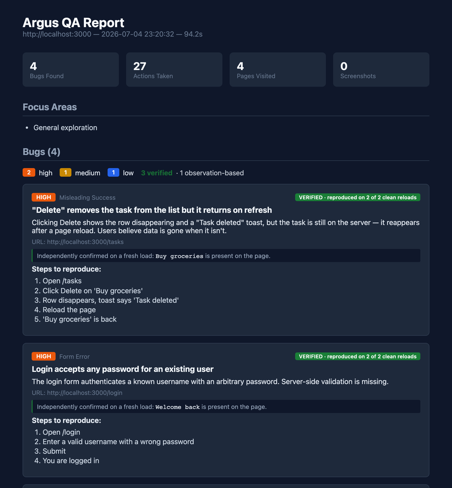

<!-- mcp-name: io.github.chriswu727/argus -->

<div align="center">


# Argus

### Browser testing for your coding agent.

[](https://pypi.org/project/argus-testing/)
[](https://github.com/chriswu727/argus/actions/workflows/ci.yml)
[](https://pypi.org/project/argus-testing/)
[](LICENSE)

[Quick start](#quick-start) · [What you get](#what-you-get) · [Engineering](#engineering) · [Documentation](#documentation) · [Product page](https://yichenwu.dev/projects/argus)

</div>

Argus is an [MCP](https://modelcontextprotocol.io/) testing server for Claude Code,
Codex, Cursor and other coding agents. It gives your existing agent browser tools
to exercise your app, check suspected bugs and produce reports with evidence.
The agent decides what to test; Argus handles browser actions, repeatable checks
and the results.

> Test my web app at http://localhost:3000 and look for bugs.

Your agent can explore user flows, inspect what changed after each action and
recheck suspected failures on a fresh page load. You can also give it specific
goals, such as testing account settings or checking whether saved data survives
a refresh.

## What you get

- **A report you can act on.** Findings include expected and actual behavior,
  reproduction steps, screenshots and verification results. Reports also show
  which testing goals were exercised, blocked or left unfinished.
- **A separate verification step.** Argus rechecks the specified symptom before
  marking it reproduced. Observations and inconclusive checks remain distinct
  from reproduced findings.
- **A regression test to keep.** Supported findings can be exported as standalone
  Playwright tests. Confirm that the test fails on the bug before adding it to
  your suite; it should pass after the behavior is fixed.

<div align="center">

</div>

For example, a task may disappear after deletion but return after a refresh.
Argus can check that behavior on fresh loads, retain the evidence and export a
test for the persistence failure. The receipt confirms that symptom; it does
not identify the root cause or fix the application.

Reports are available as **HTML, JSON, JUnit and SARIF**. Test exports currently
support findings verified through fresh-load text checks. Uploads, restored
browser state and other unsupported steps require manual translation.

## Quick start

Requires **Python 3.11+**, Chromium and an MCP-capable coding agent.
With [`uv`](https://docs.astral.sh/uv/):

```bash
uvx --from argus-testing python -m playwright install chromium
uvx --from argus-testing argus-mcp --doctor
```

Connect it to **Claude Code**:

```bash
claude mcp add argus -- uvx --from argus-testing argus-mcp
```

Or **Codex**:

```bash
codex mcp add argus -- uvx --from argus-testing argus-mcp
```

Then ask your agent to test your app. Use test accounts and data you can change:
replaying a journey can repeat its writes.

[Cursor, other MCP clients and troubleshooting](docs/usage.md#quick-start) ·
[Claude plugin](plugins/claude) · [Codex plugin](plugins/codex)

**Version 0.12.1:** generated tests keep application values in private parameters
and stop before execution when steps or configuration are incomplete. Upgrade
from 0.12.0 for these protections. See the [releases](https://github.com/chriswu727/argus/releases)
and [changelog](CHANGELOG.md#0121---2026-11-05).

## Engineering

Where to start reading the code:

- **Verification with explicit outcomes.** A completed tool call is not a passed
  application test. Checks return evidence and a reproduced, not reproduced or
  inconclusive outcome. HTTP errors and login walls stop exported checks from
  treating a missing symptom as a fix.
- **Recorded actions become reusable tests.** Exports use the controls resolved
  during the session, preserve iframe and row scope, and check the symptom on a
  fresh load. The [export tests](tests/test_export_test.py) exercise both buggy
  and fixed versions of local fixtures.
- **Separated runtime and adapters.** Session lifecycle, browser
  operations, verification and reporting are separated. The host agent supplies
  the model; Argus does not run its own model loop or require another API key.
  See the [architecture](docs/architecture.md) and [design decisions](docs/decisions.md).

Argus is still an alpha project. A fresh load normally retains authentication
and browser storage; it is not a reset of the backend. A reproduced symptom is
not proof of complete coverage or of a requirements violation. Generated tests
and screenshots should be reviewed before sharing, especially with sensitive
application data. [Privacy details](PRIVACY.md).

## Evaluation

The deterministic fixtures cover **34 seeded scenarios**. That measures what
the tools can exercise with scripted steps, not an agent's bug-discovery rate.
In a [small paired Codex evaluation](docs/evaluation-0.8.md), both Argus and the
browser baseline found all 5 predeclared defects. Argus also found one fixture
defect identified after the run and used more time and tokens. These results
do not establish general superiority.

The [evaluation guide](docs/evaluation.md) documents the method, limits and
reproduction commands. Browser and unit tests run locally without model calls;
model-based evaluations are separate and opt-in.

## Documentation

- [Usage and tool reference](docs/usage.md) — client setup, profiles, configuration and regression workflows.
- [Agent protocol](docs/agent-protocol.md) — structured results, evidence and coverage tracking.
- [Contributing](CONTRIBUTING.md) — local checks and implementation boundaries.
- [Changelog](CHANGELOG.md) · [Security](SECURITY.md) · [Privacy](PRIVACY.md).

Built by [Yichen Wu](https://github.com/chriswu727) · [yichenwu.dev](https://yichenwu.dev)
