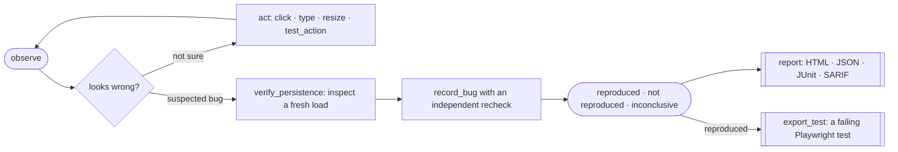

<!-- mcp-name: io.github.chriswu727/argus -->

<div align="center">


# Argus

### Testing for coding agents: explore real journeys, verify every bug, keep it fixed.

Argus is an [MCP](https://modelcontextprotocol.io/) server that gives the agent you already use
a complete testing workflow. The agent walks your app like a user, Argus independently
rechecks what looks wrong, and every finding states how it is supported.

[](https://pypi.org/project/argus-testing/)
[](https://pypi.org/project/argus-testing/)
[](https://modelcontextprotocol.io/)
[](https://registry.modelcontextprotocol.io/?q=argus)
[](#benchmarks)
[](LICENSE)

[](https://mcprush.com/to/argus-testing-autonomous-qa-mcp?ref=badge)

[Quick start](#quick-start) · [How it works](#how-it-works) · [What's new](#whats-new-in-0120) · [Why Argus](#why-argus-is-different) · [Tools](#tool-surface) · [Benchmarks](#benchmarks) · [Product page](https://yichenwu.dev/projects/argus)

English (primary) · [Simplified Chinese](https://github.com/chriswu727/argus/blob/main/README.zh-CN.md)

</div>

---

> **"Test my app at http://localhost:3000 — find real bugs."**
>
> That's the whole prompt. Your agent drives the browser through Argus, walks the
> goals you care about, rechecks every suspected bug on a fresh load, and hands back
> a report. A bug it confirms can become a Playwright test you keep in CI.

<table>
<tr>
<td width="33%" valign="top">

**🧭 Explore**

The agent acts by description
(`click_what("Delete near Buy milk")`),
reads what changed after each action, and
keeps declared goals in a coverage ledger
until each is exercised or blocked.

</td>
<td width="33%" valign="top">

**🔎 Verify**

Suspected bugs get an independent recheck on
a fresh load. Each finding is marked
reproduced, not reproduced, inconclusive or
observed, so a judgment call never passes
for a confirmed bug.

</td>
<td width="33%" valign="top">

**🛡️ Keep it fixed**

`export_test` turns a verified bug into a
standalone Playwright test that fails now and
passes once it is fixed. `regression_check`
and `argus-regression` recheck earlier
findings against new builds.

</td>
</tr>
</table>

## Quick start

Argus needs **Python 3.11+** and Chromium. With [`uv`](https://docs.astral.sh/uv/)
there is nothing to install globally:

```bash
uvx --from playwright playwright install chromium
uvx --from argus-testing argus-mcp --doctor     # checks Chromium, a real launch and the report directory
```

Each failed `--doctor` check prints the exact fix. If your default interpreter is
older than 3.11, use `uvx --python 3.12 --from argus-testing argus-mcp`. If an
upgrade reports a missing browser, run `uvx --from argus-testing python -m playwright install chromium`.

Then connect Argus to your agent:

<details open>
<summary><b>Claude Code</b></summary>

```bash
claude mcp add argus -- uvx --from argus-testing argus-mcp
```

Or install the [Claude plugin](https://github.com/chriswu727/argus/tree/main/plugins/claude),
which pins the published runtime and adds a `/argus-testing:test` skill. Run its
one-time warm-up command first, then
`/plugin install argus-testing --marketplace chriswu727/argus`. Use the plugin
instead of, not alongside, the manual connection.
Claude plugin 0.12.1 updates the isolated launcher and still runs Argus 0.12.0.

</details>

<details>
<summary><b>Codex and the ChatGPT desktop app</b></summary>

Codex CLI, the Codex IDE extension and the ChatGPT desktop app share one MCP configuration:

```bash
codex mcp add argus -- uvx --from argus-testing argus-mcp
```

Or install the [Codex plugin](https://github.com/chriswu727/argus/tree/main/plugins/codex)
with its `argus-test` skill: `codex plugin marketplace add chriswu727/argus`, then
`codex plugin add argus-testing@argus`. Use it instead of, not alongside, the manual entry.

</details>

<details>
<summary><b>Cursor</b></summary>

[](https://cursor.com/install-mcp?name=argus&config=eyJjb21tYW5kIjoidXZ4IiwiYXJncyI6WyItLWZyb20iLCJhcmd1cy10ZXN0aW5nIiwiYXJndXMtbWNwIl19)

The button adds Argus to Cursor; install Chromium as above before the first test.

</details>

<details>
<summary><b>Any stdio MCP client</b></summary>

```json
{
  "mcpServers": {
    "argus": {
      "command": "uvx",
      "args": ["--from", "argus-testing", "argus-mcp"]
    }
  }
}
```

</details>

<details>
<summary><b>pip installation</b></summary>

```bash
pip install argus-testing
playwright install chromium
claude mcp add argus -- argus-mcp
```

</details>

<details>
<summary><b>Screen mode (macOS): test native apps, not just the web</b></summary>

```bash
pip install 'argus-testing[mac]'
brew install cliclick          # keystroke / coordinate fallback
argus-mcp --doctor             # web checks plus Screen Recording + Accessibility grants
claude mcp add argus-screen -- argus-mcp --tool-profile screen
```

The same description-keyed tools, aimed at whatever app is in front on macOS (Notes,
Safari, your in-progress feature) through the Accessibility tree.

</details>

Then ask your agent to test your app. For a scoped review, it can pass
`start_session` explicit `goals`, `constraints` and an advisory
`time_budget_minutes`. To confirm the installed version, stdio handshake and
discovery without a browser or a model, run `uvx --from argus-testing python -m argus.install_check`.

---

## How it works



The agent supplies the judgment. Argus supplies:

- **Description-keyed tools.** `click_what("Login button")`, not `click(7)`. A
  description from `observe` can be passed back as-is; an ambiguous one returns
  candidates instead of a guess.
- **Actions that report what changed.** `test_action` and `test_form` return the
  before/after difference and the requests fired. Pass `expect` to predict the
  outcome, and a mismatch is flagged as a lead.
- **A coverage ledger.** Goals stay visible until marked `exercised` or `blocked`
  with evidence. Argus links the URLs, actions, screenshots and checks from
  that window automatically.
- **Reproduction receipts.** `record_bug` rechecks the stated symptom on fresh
  loads before calling it reproduced. It can also replay a recorded multi-step
  journey from a cold start.

A receipt confirms the specified observable symptom, not a root cause or that the
behavior violates the product requirements. Fresh loads keep authentication and
storage by default, and replay can repeat real writes.

### Evidence and reports

<div align="center">

</div>

Reports keep reproduced symptoms, observations and inconclusive checks apart. They
also keep goal coverage, including unfinished goals, so an incomplete pass is never
presented as exhaustive.

### From a verified bug to a regression test

When a finding is reproduced by a fresh-load text check, `export_test` writes a
standalone Playwright test that replays the recorded journey and asserts the
opposite of the symptom. It **fails while the bug is present and passes once it is
fixed**. The body of a test exported against TodoMVC, whose todos do not
survive a reload:

```python
page.goto(_url("/"))
page.get_by_placeholder("What needs to be done?", exact=True).fill("Buy milk")
page.get_by_placeholder("What needs to be done?", exact=True).press("Enter")
page.wait_for_load_state("networkidle")
page.get_by_placeholder("What needs to be done?", exact=True).fill("Walk dog")
page.get_by_placeholder("What needs to be done?", exact=True).press("Enter")
page.wait_for_load_state("networkidle")
_in_row(page, "Walk dog", lambda scope: scope.locator("input[type=\"checkbox\"]")).click()
page.wait_for_load_state("networkidle")
page.goto("about:blank")
page.goto(_url("/"))
assert _present("Walk dog", page), SYMPTOM_MARKER + ": 'Walk dog' is missing"
```

- **Stable locators.** They are captured from the elements Argus actually
  resolved. A repeated control is scoped to its row by the row's title, not by
  position.
- **No secrets in the file.** Passwords and tokens are read from environment
  variables.
- **No pass from a broken page.** HTTP errors and login walls stop the check;
  a missing symptom on those pages does not mean the bug is fixed.
- **Nothing guessed.** Steps Argus cannot translate are marked `TODO(argus)` and
  listed.
- **Optional run.** `run=true` runs the file once to show that it fails on the
  symptom. Because this repeats the journey's writes, use it only on data you may
  change.

<details>
<summary><b>Live monitoring from a real local fixture run</b></summary>

`--monitor-port 8765` adds a local read-only dashboard of actual runtime events
(sessions, checks, findings), not model reasoning or a simulated percentage. The
run below captured a saved-name persistence failure, one reproduction receipt
and two exercised goals.


</details>

---

## What's new in 0.12.0

- **Verified bug → regression test.** New `export_test` writes a Playwright test
  from a reproduced finding; it fails now and passes once the bug is fixed.
- **Ready-made skills.** `/argus-testing:test` in the Claude plugin and
  `argus-test` in the new Codex plugin run a full review: goals, the
  `test_action` expectations, a visual pass with `screenshot` and `check_layout`,
  verified findings and a coverage summary.
- **Real-app interactions.** Found by testing TodoMVC and Flask's tutorial app:
  - controls that appear only on hover;
  - double-click to edit, including on plain text;
  - confirm dialogs, reported or accepted with `accept_dialog=true`;
  - fields named only by a nearby label;
  - going back and scrolling, which are now part of replays and exports.
- **Sharper resolution.** Descriptions copied from `observe` resolve as-is.
  `test_form` sets checkboxes and radios. Text checks handle punctuation at the
  edges of a target.
- **`--doctor` for web testing.** It launches Chromium for real and checks the
  report directory, on every platform.

**Upgrading from 0.11:** the `web` profile has 29 tools (was 28), adding
`export_test`. See the [changelog](CHANGELOG.md) for every change.

<details>
<summary><b>Earlier releases</b></summary>

### What's new in 0.11.0

- **One complete default loop:** the 28-tool `web` profile covers exploring,
  acting, verifying, recording, reporting and `regression_check`. `advanced`
  adds network, state, tab, coordinate and crawl controls.
- **Lighter install:** the legacy LLM-planner CLI and LiteLLM are gone; a fresh
  runtime install resolves 41 packages instead of 82. Benchmarks and evaluations
  live in the repository-only `argus_lab` package.
- **Sharper evidence:** presence is conclusive even on error pages, `expect_status`
  covers intended 404s, re-finalized goals keep their evidence window current,
  and rechecks record which attempt produced a verdict.

**Upgrading from 0.10:** `agent` and `core` still start the server but now load
`web`. Former `agent` users get 28 tools instead of 19 (discovery payload 34,379
bytes versus 24,386); former `core` users get 28 instead of 30 (versus 51,732
bytes on Python 3.11/3.12, 50,564 on 3.13) and find `check_links` and
`check_performance` in `advanced`. The `argus <url>` command is removed.

</details>

---

## Why Argus is different

**Exploratory testing with a repeatable evidence trail.** The agent investigates
journeys beyond prewritten checks, Argus rechecks what it suspects, and the
results stay honest about what was and was not confirmed.

| | |
|---|---|
| **Agent-directed & black-box** | Give your agent a URL and scope. It explores without application source access or prewritten scripts. |
| **Coverage contract** | Natural-language goals, constraints, discovered pages and an advisory time budget stay visible through the session and in the final report. |
| **Reproduction receipts** | Independent checks separate reproduced, not-reproduced and inconclusive symptoms from the agent's own observations. |
| **Runtime evidence** | Misleading success messages, cross-page inconsistencies and persistence failures are caught in the running app; the agent judges them against the intended behavior. |
| **Discover → guard** | `export_test` turns a verified bug into a Playwright test for your suite; `argus-regression` rechecks journaled findings in CI without model calls. |
| **Machine-readable** | Structured MCP results plus JSON, JUnit and SARIF exports for downstream tools. |

### How it compares

[Microsoft's Playwright MCP](https://github.com/microsoft/playwright-mcp#readme)
provides browser automation, with opt-in test assertions (`--caps=testing`) such
as verifying visible text or element values. Argus is organized around the whole
testing process instead: goals declared up front and tracked to evidence,
persistence checks after writes, findings linked to the actions, checks and
screenshots behind them, independent rechecks, and regression tests and rechecks
of earlier findings against later builds. Argus includes its own browser control
and can run alongside other tools. It does not replace the host model's judgment
or guarantee discovery of every defect.

The [paired evaluation](docs/evaluation.md) compares a conventional Playwright
MCP adapter with Argus using the same host and tasks. That adapter is not the
official Playwright MCP package, and these results must not be presented as a
ranking of third-party products.

---

## Benchmarks

Benchmarks and evaluations run from a source checkout (`argus_lab/`); they are not part of the installed package.

```
$ python -m argus_lab.bench --target all

  buggytasks    22 / 22  = 100 %   ·  mechanical bugs (console errors, fake delete, auth bypass…)
  darkshop      12 / 12  = 100 %   ·  human-eye bugs (fake scarcity, lying toasts, stale state…)
  ──────────────────────────────────────────────────────────────────────
  total         34 / 34  = 100 %   ·  reproducible from git clone in two commands
```

`34 / 34` is the **capability ceiling**: what is *findable* through the tool surface,
measured by deterministic scripts. It is deliberately separate from *how often a
given model uses the tools well*, which is noisy and reported separately.

Does installing Argus improve an agent? Measure it with the
[paired evaluation harness](docs/evaluation.md): the same model, task, fixture,
initial state and budget, with both arms and failures retained. In the
[0.8 Codex evaluation](docs/evaluation-0.8.md), ten matched pairs, Argus found
6/6 defect opportunities versus 5/6 for the browser baseline, including one
post-hoc fixture defect. Both had zero observed false positives and equal
declared-goal coverage. Argus used more time and tokens. On four repeated pilot
cases, the targeted update reduced Argus's median calls from 17 to 9. This small
synthetic sample does not establish general superiority.

The no-model [response encoding benchmark](docs/evaluation.md#response-overhead)
compares identical synthetic evidence. Delta mode reduces aggregate result JSON
by 48.25% versus compact mode across those 24 responses, reproduced with 0.12.0.
This measures bytes, **not agent token usage or testing quality**.

<details>
<summary><b>What the fixtures seed</b></summary>

**BuggyTasks** (`:5555`): 22 mechanical bugs in a task app, including console
errors, dead links, a fake delete (the UI says "deleted!" but the data persists on
refresh), auth bypass, NaN dates, off-by-one counts and race conditions. This is
the "scripted E2E could find these" tier.

**DarkShop** (`:5556`): 12 seeded runtime and visual scenarios in a polished-looking
store. They include:
- a hardcoded "Only 3 left!" scarcity claim;
- `-50%` badges where the sale price equals the original;
- a "free shipping over $50" banner contradicted by a flat `$5` at checkout;
- inverted visual hierarchy ("Add to Cart" demoted under a prominent "Subscribe");
- cross-page state drift (a rename sticks on /account, but the navbar greeting doesn't change).

```bash
python test-site/app.py           # BuggyTasks  :5555
python human-eye-fixture/app.py   # DarkShop    :5556
python -m argus_lab.bench --target all
```

</details>

---

## Tool surface

`argus-mcp` starts with the `web` profile: one complete testing loop of exploring, acting, verifying, recording, reporting and re-checking earlier findings. The counts are also available from the installed server:

```bash
uvx --from argus-testing argus-mcp --list-tools
uvx --from argus-testing argus-mcp --tool-profile advanced --list-tools
uvx --from argus-testing argus-mcp --tool-profile screen --list-tools
```

| Profile | Public tools | Intended use |
|---------|-------------:|--------------|
| `web` | 29 | The complete browser testing loop with concise tool descriptions; the default. |
| `advanced` | 62 | Everything in web, plus network mocks, cookies and storage, tabs, dialogs, waits, coordinate input, crawling, and link and performance probes. |
| `screen` | 14 | Native macOS testing through Accessibility and screenshots; enabled separately. |
| `full` | 78 | Every web and screen tool, including screen coordinate input. |

Earlier profile names still start the server: `agent` and `core` load the `web` profile, so their tool sets change (19 → 29 and 30 → 29 tools).

<details>
<summary><b>Web profile — 29 tools</b></summary>

| Tools | Purpose |
|-------|---------|
| `start_session` | Start an `exploratory`, `visual`, or `regression` browser review; optionally accept `goals`, `constraints`, and `time_budget_minutes`; return the one-time protocol and initial observation. |
| `observe` | Return URL, title, description-keyed interactive elements, counts, visible feedback, ARIA tree, and viewport state. |
| `coverage_update` | Open a goal evidence window with `in_progress`, then mark it `exercised` or `blocked`; terminal states require an explanation and automatically link session evidence. |
| `click_what` | Click the element best matching a natural-language description; return candidates instead of guessing when ambiguous. |
| `type_into` · `select_into` | Resolve a field by description, then type text or select an option. |
| `hover_what` · `press_key` | Exercise hover states and keyboard interactions against description-keyed targets. |
| `resize` · `emulate_device` | Test responsive breakpoints or reopen the page under real mobile touch, UA, DPR, and viewport settings. |
| `upload_file` | Attach one or more local files to a matching file input. |
| `navigate` · `go_back` · `scroll_down` | Navigate directly, return through browser history, or reveal content below the fold. |
| `inspect_element` · `check_layout` | Inspect computed styles, ARIA and markup, or bounded overflow, clipping, small-target, and overlay signals. |
| `screenshot` · `screenshot_diff` | Capture viewport, full-page, or element evidence and produce a red-tint pixel-diff overlay. |
| `get_errors` | Drain correlated console errors and HTTP 4xx/5xx events captured since the previous read. |
| `capsule_save` · `capsule_restore` | Save and restore a named authenticated or seeded browser state, with an optional liveness check. |
| `verify_persistence` | Force a fresh load and return target presence plus the page observation. This checks persistence, not semantic correctness. |
| `test_action` · `test_form` | Perform a description-keyed action or form submission and return the resulting state diff in one round trip. |
| `regression_check` | Re-test journaled findings for the current origin without requiring another discovery pass. |
| `record_bug` · `record_observation` | Record a finding with evidence and its recheck outcome, or keep a qualitative review note separate. Inspect the receipt rather than treating recording as confirmation. |
| `export_test` | Write a standalone Playwright test from a finding verified on a fresh load: it replays the recorded journey and asserts the opposite of the symptom, so it fails while the bug is present and passes once it is fixed. |
| `end_session` | Atomically apply optional final `coverage_updates`, close the active session, and emit HTML, JSON, JUnit, and SARIF reports. Invalid updates keep the session open. |

</details>

<details>
<summary><b>Screen profile — 14 tools</b></summary>

| Tools | Purpose |
|-------|---------|
| `start_screen_session` | Bind to the foreground or a named macOS app after checking Screen Recording and Accessibility permissions. |
| `screen_observe` | Return the foreground app, window title, bounded AX tree, screen coordinates, and a fresh screenshot. |
| `screen_click_what` · `screen_type_into` · `screen_press_key` | Resolve against the AX tree and act through native accessibility, falling back to `cliclick`. |
| `screen_wait_for_stable` | Wait until the target window remains visually stable within a configurable threshold. |
| `screen_launch` · `screen_quit` · `screen_is_running` | Control and inspect an app by localized name, bundle ID, or absolute path. |
| `screen_screenshot_region` | Capture a precise rectangular screen region for fine visual evidence. |
| `screen_session_status` | Report elapsed time, remaining session budget, action counts, and the abort-file path. |
| `record_bug` · `record_observation` · `end_session` | Use the shared evidence, reporting, and teardown tools in screen mode. |
| `screen_click_at` · `screen_hover_at` · `screen_drag` · `screen_keys` · `screen_type_at` | Only in `full`: absolute screen coordinates and multi-key sequences when a native app exposes no useful AX element. |

**Safety:** per-call timeout, a 30-minute session cap, a `~/.argus/abort` panic file that halts every subsequent action, and an automatic before/after screenshot trail on every action.

</details>

<details>
<summary><b>Advanced profile — 62 tools</b></summary>

The advanced profile includes every web tool above plus these 33 tools. Use it when a test genuinely needs low-level state, fault injection, multi-tab control, coordinates, or crawling.

| Additional tools | Purpose |
|------------------|---------|
| `paste_into` · `right_click` | Fire a real clipboard paste event or open a target's context menu. |
| `emulate_media` | Emulate dark/light color schemes and reduced-motion preferences. |
| `click_at` · `type_at` · `hover_at` · `drag_at` · `drag_what` | Exercise canvas/WebGL, hover-reveal, and drag-and-drop interfaces by coordinates or description. |
| `drop_file` | Dispatch a real file drop onto a matching dropzone. |
| `set_dialog_handler` | Queue an accept, dismiss, or prompt response for the next JavaScript dialog. |
| `eval_js` | Run arbitrary page-context JavaScript. It remains disabled unless the server also starts with `--unsafe`. |
| `network_requests` · `network_request` | Inspect the bounded request log or retrieve full detail for one matching request. |
| `network_mock` · `network_unmock` · `network_clear_mocks` · `network_clear_log` | Inject canned HTTP responses and independently reset active mocks or captured traffic. |
| `cookies_get` · `cookies_set` · `cookies_clear` | Inspect, seed, or clear browser-context cookies. |
| `storage_get` · `storage_set` · `storage_remove` · `storage_clear` | Inspect and mutate page-local `localStorage` or `sessionStorage`. |
| `tabs_list` · `tabs_switch` · `tabs_close` | Control OAuth, payment, and other popup or multi-tab journeys. |
| `wait_for_text` · `wait_for_request` | Wait for specific visible text or matching outgoing traffic with a bounded timeout. |
| `get_downloads` | Inspect files downloaded during the session, including their paths and sizes. |
| `crawl_site` | Crawl bounded internal pages and collect browser events, link results, and performance evidence. |
| `check_links` · `check_performance` | Probe current-page internal links and expose raw browser performance metrics without auto-certifying generic audit findings. |

To expose `eval_js` as an operational tool rather than a disabled safety stub:

```bash
uvx --from argus-testing argus-mcp --tool-profile advanced --unsafe
```

</details>

---

## Configuration and operations

<details>
<summary><b>Structured results and response modes</b></summary>

Tool responses keep their text and images and add a versioned `structuredContent`
envelope with an output schema. Long workflows emit real phase notifications to
clients that request progress; clients that do not display them still receive the
phase summary in the final result. See the [agent protocol](docs/agent-protocol.md).

For agents that read structured results, add compact responses (the monitor is optional):

```bash
uvx --from argus-testing argus-mcp --response-mode compact --monitor-port 8765
```

`--response-mode delta` is an additional opt-in for clients that can retain and
merge snapshot IDs; keep `compact` if the host cannot reliably resolve bases. Missing
bases require a full `observe`, and verification outcomes and images are never
replaced by cached verdicts. See the [snapshot contract](docs/agent-protocol.md#incremental-observations).

Since 0.10.0, switching to another goal group freezes the previous evidence window
without completing those goals. Deferred findings can name `evidence.goal` or
`evidence.goals`, and fresh-load findings capture the checked page before returning
to the agent's page. See the [evidence contract](docs/agent-protocol.md#finding-evidence-provenance).

</details>

<details>
<summary><b>Regression gates in CI</b></summary>

```bash
argus-regression http://localhost:3000 --output ./argus-reports
```

Exit codes: `0` no known symptom reproduced (or no journal), `1` a known symptom
still reproduces, `2` operational/storage failure, `3` inconclusive. An exit of
zero is not proof of complete application correctness. Automatic regression
uses built-in text/HTTP checks, never write-performing replay. Tests written by
`export_test` run in your own test suite instead.

</details>

<details>
<summary><b>Live monitoring</b></summary>

```bash
argus-mcp --monitor-port 8765
# Or choose an available port automatically:
argus-mcp --monitor-port 0
```

Open `http://127.0.0.1:8765` for session state, active operation and duration,
last progress, calls, operational failures, findings and recent events. The
selected URL is printed to **stderr**, so stdio MCP messages stay intact.
`ARGUS_MONITOR_PORT` is equivalent; monitoring is off by default.

| Route | Output |
|---|---|
| `/` | Local live dashboard |
| `/healthz` | HTTP process liveness |
| `/readyz` | Runtime initialized and not shutting down; 503 otherwise |
| `/api/status` | Versioned state snapshot, counts, capture drops and numeric overhead |
| `/api/events` | Server-Sent Events, `Last-Event-ID` reconnect and gap notices |
| `/metrics` | Prometheus operation, response-byte and component-timing counters |

The monitor binds only to `127.0.0.1`, rejects unrelated Host/Origin headers,
and has no action endpoints. It emits no page contents, URLs, typed values,
screenshots or tool arguments. It is **not an authenticated remote service**;
do not expose it through a public proxy. Event retention is bounded (512 by
default), with at most 32 simultaneous SSE subscribers.

</details>

<details>
<summary><b>Runtime settings, artifacts and limits</b></summary>

Explicit command-line options override environment variables, which override defaults:

| Environment variable | Default |
|---|---:|
| `ARGUS_OPERATION_TIMEOUT_S` | 120 seconds |
| `ARGUS_QUEUE_TIMEOUT_S` | 5 seconds |
| `ARGUS_CLEANUP_TIMEOUT_S` | 10 seconds per backend |
| `ARGUS_EVENT_CAPACITY` | 512 events |
| `ARGUS_OUTPUT_DIR` | `./argus-reports` |

One runtime owns one active session. Actions and lifecycle changes are
serialized; an operation timeout cancels the action and closes the backend.
Side-effecting actions are never automatically retried. A separate MCP process
is the supported way to run another independently controlled session.

Each run writes its screenshots into its own directory. Reports keep original
screenshots and, by default, reference compact WebP previews under
`report-assets/`; set `ARGUS_PORTABLE_REPORT=1` for a single self-contained HTML
file. Cleanup is explicit and dry-run by default; `.argus` journals and state
capsules are never deleted:

```bash
argus-cleanup --output ./argus-reports --keep-runs 20
argus-cleanup --output ./argus-reports --keep-runs 20 --apply
```

Use `--older-than-days` and `--max-size-mb` for stricter policies. Long sessions
keep bounded event logs (`ARGUS_MAX_NETWORK_EVENTS`, `ARGUS_MAX_ERROR_EVENTS`,
`ARGUS_MAX_DOWNLOAD_EVENTS`, `ARGUS_MAX_DIALOG_EVENTS`) and only read response
bodies for inspectable API traffic (`ARGUS_MAX_RESPONSE_BODY_BYTES`,
`ARGUS_MAX_RESPONSE_READ_BYTES`, `ARGUS_CAPTURE_UNKNOWN_LENGTH_BODY=1`). When a
limit discards old evidence, Argus says so in tool output and the session summary.
Editable installs must be reinstalled after a version change so their metadata
matches the source.

</details>

---

## Local-first security and privacy

Argus runs on your machine and does not send telemetry to an Argus-operated service. Reports and screenshots stay under `./argus-reports` by default; your MCP host and its configured model provider can still receive tool results included in the conversation. Browser actions and native macOS controls can cause real side effects, so use test accounts and non-production data wherever possible.

- **Inputs:** typed, pasted and selected values are held in a session-local
  input vault, not in action traces or exported replay steps. Exported steps that
  need input are marked `requires_input`.
- **Exported tests:** sensitive inputs are read from environment variables.
- **Capsules:** they deliberately contain credentials and are saved with
  owner-only permissions.
- **Approved directories only:** local file uploads and `file://` pages require a
  directory approved in `ARGUS_FILE_ROOTS`.
- **Hidden values:** cookie and storage values are hidden unless
  `ARGUS_ALLOW_SENSITIVE_READS=1`.

Configure these in the MCP host's server environment, not through page content or tool arguments:

```json
{
  "ARGUS_FILE_ROOTS": "[\"/absolute/path/to/test-fixtures\"]",
  "ARGUS_ALLOWED_ORIGINS": "[\"http://localhost:3000\"]"
}
```

The optional origin policy restricts tool targets, not browser network egress.
Read the full [privacy disclosure](PRIVACY.md) and [security policy](SECURITY.md)
before using Argus against sensitive systems.

---

## Philosophy

<details>
<summary><b>Trust the agent, don't simulate intelligence</b></summary>

The host agent makes semantic judgments. Argus supplies bounded observations,
deterministic checks, evidence-linked coverage and explicit uncertainty.
Guidance suggests applicable probes; it never silently executes them or treats
a heuristic as a confirmed defect. Browser events are captured as observations,
not proof that the user-facing behavior is wrong.

</details>

<details>
<summary><b>Guide the review; don't hijack the host task</b></summary>

The global instruction is intentionally tiny so it does not repeat a long QA prompt in every MCP tool description. `start_session` returns the full evidence-first ritual, goals, constraints, and budget once; observations then surface only the compact live coverage ledger. Argus remains a capability inside the user's current task: it does not prevent implementation work, replace the host's identity, or imply authority for irreversible external actions.

</details>

<details>
<summary><b>Description-keyed, not index-keyed</b></summary>

`click_what("Login button")`, not `click(7)`. Element indices are a leaky abstraction even within one `observe`. A capable agent describes what it wants by what it *is*, and the resolver maps that to the right element — refusing to misclick on ambiguity rather than guessing.

</details>

---

## Project layout

```
argus/
├── mcp_server.py      # process entry point and compatibility imports
├── entrypoints/mcp/   # public tool catalog, profiles and MCP adaptation
├── application/       # session manager and focused QA use cases (incl. test export)
├── domain/            # models, errors, states, replay and verification contracts
├── adapters/          # monitoring, logs, file journal, report service and exporters, JS assets
├── bootstrap.py       # composition root: injected backend/repository factories
├── ports.py           # narrow lifecycle, observation, verification and storage protocols
├── settings.py        # validated, per-runtime configuration
├── browser.py         # Playwright adapter (public operations; private page ownership)
├── screen/            # macOS AX adapter, permissions, safety
├── resolver.py        # description → element (web + screen)
└── cli.py             # argus-regression and argus-cleanup commands
argus_lab/            # repository-only: not in the installed wheel
├── evaluation/        # paired schemas, isolated fixtures, opt-in host runner, adjudication
└── bench/             # deterministic capability benchmark
plugins/              # Claude and Codex plugin bundles with the test skills
test-site/            # BuggyTasks  (22 mechanical bugs)
human-eye-fixture/    # DarkShop    (12 human-eye bugs)
```

Start with [Architecture](docs/architecture.md), [design decisions](docs/decisions.md)
and [Contributing](CONTRIBUTING.md) for implementation boundaries, tests and
extension points.

---

<div align="center">

**MIT licensed** · [Product page](https://yichenwu.dev/projects/argus) · [Agent install guide](llms-install.md) · [Privacy](PRIVACY.md) · [Security](SECURITY.md) · Built by [Yichen Wu](https://github.com/chriswu727)

</div>
