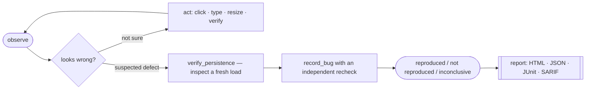

<!-- mcp-name: io.github.chriswu727/argus -->

<div align="center">


# Argus

**A testing-engineer toolkit for AI agents—explore user journeys, check outcomes, and reproduce bug symptoms with evidence, through MCP.**

Argus is an [MCP](https://modelcontextprotocol.io/) server that gives your coding agent a testing workflow: evidence-backed coverage, action-and-observation tools, persistence checks, independent reproduction receipts, and live progress. The host agent decides what to investigate; Argus helps it check what actually happened. Browser QA works across platforms, with a separate native macOS tool profile.

[](https://pypi.org/project/argus-testing/)
[](https://pypi.org/project/argus-testing/)
[](https://modelcontextprotocol.io/)
[](https://registry.modelcontextprotocol.io/?q=argus)
[](#benchmarks)
[](LICENSE)

[](https://mcprush.com/to/argus-testing-autonomous-qa-mcp?ref=badge)

[Product page](https://yichenwu.dev/projects/argus) · [Quick start](#quick-start) · [Why Argus](#why-argus-is-different) · [Compared](#how-it-compares) · [Tools](#tool-surface) · [Benchmarks](#benchmarks)

</div>

---

## Agent-first testing

Argus adds a testing workflow to the agent you already use: inspect, act,
check persistence, independently reproduce a symptom, and link the evidence.
HTML reports are an optional way to review the evidence, not the agent interface.

Since 0.8.0, tool responses preserve their text and
images while adding a versioned `structuredContent` envelope and output schema.
Core actions, observation, verification, findings, coverage and report operations expose
machine-readable data; other tools currently expose status/error metadata with
their existing content. Long workflows emit real phase notifications to MCP
clients that request progress. Clients that do not display them still receive
the phase summary in the final result. See the [agent protocol](docs/agent-protocol.md).

- **Coverage guidance:** up to four evidence-based next checks, outstanding goals,
  persistence reminders, input-boundary probes and stalled-exploration detection.
- **Action + observation:** click, fill, select, navigate and keyboard actions
  return the current page evidence, reducing the need for a separate observation.
- **Conservative checks:** missing or malformed evidence stays unknown, not a
  guessed pass or a fabricated bug. Findings link to stable session references.
- **Focused agent mode:** `argus-mcp --tool-profile agent --response-mode compact`
  exposes 19 common testing tools with concise discovery descriptions, preserves structured evidence,
  and avoids repeating migrated payloads as prose. Compatible mode remains the default.
- **Visible progress:** real phases, goal counts and check counts over MCP;
  `--monitor-port 8765` adds the local live dashboard without exposing goal text.
- **Measured response overhead (0.9):** smaller output schemas, numeric payload
  and component-timing counters, and opt-in `--response-mode delta` for clients
  that retain observation snapshots. Missing bases require a full `observe`;
  verification outcomes and image blocks are never replaced by cached verdicts.

Does installing Argus improve an agent? Measure it with the
[paired evaluation harness](docs/evaluation.md): the same model, task, fixture,
initial state and budget, with both arms and failures retained. The local scripted smoke
suite validates the harness; it is **not evidence of agent performance gains**.

Development main (not yet in 0.9.1) adds read-only persistence-verification
guidance, bounded rechecks by finding ID, shared coverage evidence in compact
responses, and text/value-aware change summaries. It also supports final
coverage updates inside `end_session`, smaller input schemas, and compact
envelopes that omit empty optional metadata. See the
[protocol](docs/agent-protocol.md#bounded-verification-recovery-unreleased).

The [0.8 Codex evaluation](docs/evaluation-0.8.md) includes ten matched pairs:
Argus found 6/6 defect opportunities versus 5/6 for the browser baseline, including
one post-hoc fixture defect. Both had zero observed false positives and equal
declared-goal coverage. Argus used more time and tokens. On four repeated pilot
cases, the targeted update reduced Argus's median calls from 17 to 9; this small
synthetic sample does not establish general superiority.

The no-model [response encoding benchmark](docs/evaluation.md#response-overhead)
compares identical synthetic evidence, including navigation invalidation. Delta
mode reduces aggregate result JSON by 47.09% versus compact mode across those
24 responses; this measures bytes, **not agent token usage or testing quality**.

<details>
<summary><b>Live monitoring from a real local fixture run</b></summary>

The dashboard below captured a saved-name persistence failure, one independent
reproduction receipt and two exercised goals. It shows actual runtime events,
not model reasoning or a simulated percentage. MCP hosts decide whether to display
progress notifications; the local dashboard works independently of that UI choice.


Reproduce without a model: run `pytest tests/test_monitoring.py` after installing
development dependencies and Chromium.

</details>

## Evidence and reports

Give it a URL; get a report of bugs — each tagged with whether Argus **independently reproduced it** or only observed it:

<div align="center">

</div>

A reproduction receipt shows whether a specified symptom survived an independent
recheck. It does not, by itself, prove a root cause or that the behavior violates
the product requirements. Observations, inconclusive checks and reproduced
symptoms remain distinguishable in the agent result and exported evidence.

---

## How it works



The agent supplies the judgment. Argus supplies concise QA guidance, a description-keyed tool surface (`click_what("Login button")`, not `click(7)`), a goal coverage ledger, and a **reproduction-receipt engine** that distinguishes observed, reproduced and inconclusive symptoms.

A receipt confirms the specified observable symptom, not every possible root
cause. A clean load preserves authentication and browser storage by default;
replay can repeat real writes. Qualitative observations and inconclusive checks
remain distinct from verified findings.

---

## Quick start

Argus 0.7.1 and newer require **Python 3.11+**. If your default interpreter is
older, use `uvx --python 3.12 --from argus-testing argus-mcp` in your MCP
configuration. Upgrade Python before upgrading an existing pip installation.

With [`uv`](https://docs.astral.sh/uv/) installed, no global Python package install is required. Install Chromium once:

```bash
uvx --from playwright playwright install chromium
```

Then connect Argus to your MCP client.

### Claude Code

```bash
claude mcp add argus -- uvx --from argus-testing argus-mcp
```

### Codex and the ChatGPT desktop app

Codex CLI, the Codex IDE extension, and the ChatGPT desktop app share the same local MCP configuration:

```bash
codex mcp add argus -- uvx --from argus-testing argus-mcp
```

### Cursor

[](https://cursor.com/install-mcp?name=argus&config=eyJjb21tYW5kIjoidXZ4IiwiYXJncyI6WyItLWZyb20iLCJhcmd1cy10ZXN0aW5nIiwiYXJndXMtbWNwIl19)

The button adds Argus to Cursor; run the Chromium installation command above once before the first test.

### Any stdio MCP client

```json
{
  "mcpServers": {
    "argus": {
      "command": "uvx",
      "args": ["--from", "argus-testing", "argus-mcp"]
    }
  }
}
```

The default `core` profile exposes the primary web-testing workflow without flooding the host with every specialist tool. Use `uvx --from argus-testing argus-mcp --list-tools` to inspect the selected profile, `--tool-profile screen` for native macOS testing, or `--tool-profile full` for the entire advanced surface. `ARGUS_TOOL_PROFILE` provides the same setting through the environment.

For agents that read structured MCP results, use the focused configuration:

```bash
uvx --from argus-testing argus-mcp --tool-profile agent --response-mode compact --monitor-port 8765
```

Read returned observations before issuing another `observe`. Batch related goals
with `coverage_update(goal=["edit profile", "reload profile"], status="in_progress")`;
finish them with observed evidence, not an assumed pass. The monitor stays local.

`--response-mode delta` is an additional opt-in for clients that can retain and
merge snapshot IDs. Keep `compact` if the host cannot reliably resolve bases.
See the [snapshot contract](docs/agent-protocol.md#incremental-observations).

To check installation, product version, stdio handshake, discovery and structured
errors without opening a browser or calling a model:

```bash
uvx --from argus-testing python -m argus.install_check
```

Editable installs must be reinstalled after a version change so their package
metadata matches the source. MCP `serverInfo.version` now reports Argus's version,
not the MCP SDK version.

Then just ask, in your agent session:

> **"Test my app at http://localhost:3000 — find real bugs."**

That's it. The agent drives; Argus keeps it honest and writes the report.

For a scoped review, the host can give `start_session` explicit `goals`, `constraints`, and an advisory `time_budget_minutes`. Argus returns the full testing protocol once and keeps outstanding goals and discovered pages visible in later observations. Mark a goal `in_progress` before its journey; when `coverage_update` marks it `exercised` or `blocked`, Argus requires a concrete explanation and automatically links the URLs, value-redacted actions, screenshots, persistence checks, bugs, and observations produced in that testing window. The final HTML and JSON reports preserve both completed and unfinished coverage instead of implying that an incomplete pass was comprehensive.

<details>
<summary><b>pip installation</b></summary>

```bash
pip install argus-testing
playwright install chromium
claude mcp add argus -- argus-mcp
```

</details>

<details>
<summary><b>CLI mode (no MCP host — bring your own LLM)</b></summary>

```bash
# Uses a LiteLLM-backed planner. Set a provider key (OPENAI_API_KEY, DEEPSEEK_API_KEY, …).
uvx --from argus-testing argus http://localhost:3000 --model deepseek/deepseek-chat

# Higher recall: union N independent passes (deduped, proven instance kept)
uvx --from argus-testing argus http://localhost:3000 --passes 3
```

</details>

<details>
<summary><b>Screen mode (macOS) — test any native app, not just the web</b></summary>

```bash
pip install 'argus-testing[mac]'
brew install cliclick          # keystroke / coordinate fallback
argus-mcp --doctor             # check Screen Recording + Accessibility grants
claude mcp add argus-screen -- argus-mcp --tool-profile screen
```

Same description-keyed tools, but the target is whatever app is foreground on macOS — Notes, Cursor, Safari, your in-progress feature. No headless Chrome, no scripted Playwright. Argus sees what you see, via the Accessibility tree.

</details>

### Artifact and resource limits

Argus writes each run's screenshots into its own run directory so later tests
cannot overwrite earlier evidence. Long browser sessions also keep bounded
in-memory event logs and only read response bodies for inspectable API traffic;
binary and oversized bodies are skipped before they enter Python memory.

Report cleanup is explicit and dry-run by default. The newest 20 complete runs
are protected in this example; `.argus` journals and state capsules are never
deleted:

```bash
argus-cleanup --output ./argus-reports --keep-runs 20
argus-cleanup --output ./argus-reports --keep-runs 20 --apply
```

Use `--older-than-days` and `--max-size-mb` for stricter policies. Advanced
limits can be adjusted with `ARGUS_MAX_NETWORK_EVENTS`,
`ARGUS_MAX_ERROR_EVENTS`, `ARGUS_MAX_DOWNLOAD_EVENTS`,
`ARGUS_MAX_DIALOG_EVENTS`, `ARGUS_MAX_RESPONSE_BODY_BYTES`, and
`ARGUS_MAX_RESPONSE_READ_BYTES`. Responses without a declared length are skipped
by default; `ARGUS_CAPTURE_UNKNOWN_LENGTH_BODY=1` opts into reading them. When a
limit discards old evidence, Argus says so in tool output and the final session
summary.

### Live monitoring (0.7)

Add a monitor port to the command your MCP client launches:

```bash
argus-mcp --monitor-port 8765
# Or choose an available port automatically:
argus-mcp --monitor-port 0
```

Open `http://127.0.0.1:8765` for session state, active operation and duration,
last progress, calls, operational failures, findings and recent events. The
selected URL is printed to **stderr**, so stdio MCP messages stay intact.
`ARGUS_MONITOR_PORT` is equivalent; monitoring is off by default.

| Route | Output |
|---|---|
| `/` | Local live dashboard |
| `/healthz` | HTTP process liveness |
| `/readyz` | Runtime initialized and not shutting down; 503 otherwise |
| `/api/status` | Versioned state snapshot, counts, capture drops and numeric overhead |
| `/api/events` | Server-Sent Events, `Last-Event-ID` reconnect and gap notices |
| `/metrics` | Prometheus operation, response-byte and component-timing counters |

The monitor binds only to `127.0.0.1`, rejects unrelated Host/Origin headers,
and has no action endpoints. It emits no page contents, URLs, typed values,
screenshots or tool arguments. It is **not an authenticated remote service**;
do not expose it through a public proxy. Event retention is bounded (512 by
default), with at most 32 simultaneous SSE subscribers.

Runtime settings are validated at startup. Explicit command-line options
override environment variables, which override defaults:

| Environment variable | Default |
|---|---:|
| `ARGUS_OPERATION_TIMEOUT_S` | 120 seconds |
| `ARGUS_QUEUE_TIMEOUT_S` | 5 seconds |
| `ARGUS_CLEANUP_TIMEOUT_S` | 10 seconds per backend |
| `ARGUS_EVENT_CAPACITY` | 512 events |
| `ARGUS_OUTPUT_DIR` | `./argus-reports` |

One runtime owns one active session. Actions and lifecycle changes are
serialized; an operation timeout cancels the action and closes the backend.
Side-effecting actions are never automatically retried. A separate MCP process
is the supported way to run another independently controlled session.

### Regression gates and evidence privacy

```bash
argus-regression http://localhost:3000 --output ./argus-reports
```

Exit codes: `0` no known symptom reproduced (or no journal), `1` a known symptom
still reproduces, `2` operational/storage failure, `3` inconclusive. An exit of
zero is not proof of complete application correctness. Automatic regression
uses built-in text/HTTP checks, never write-performing replay.

Typed, pasted and selected input values are held in a session-local input vault,
not in action traces or exported replay steps. Exported steps that need input
are marked `requires_input`; they cannot be replayed as if a redacted value were
real. Capsules deliberately contain credentials and are saved with owner-only
file permissions on POSIX. Reports and screenshots can still contain visible
application data; see [Privacy](PRIVACY.md).

---

## Why Argus is different

**Give exploratory testing a repeatable evidence workflow.** An agent can use
Argus to investigate journeys beyond prewritten checks, inspect what changed,
and independently recheck suspected symptoms. The agent still decides whether
the observed behavior violates the application's requirements; a reproduction
receipt is supporting evidence, not a guarantee of correctness or zero false positives.

| | |
|---|---|
| **Agent-directed & black-box** | Give your agent a URL and scope. It explores through Argus without requiring application source access or prewritten test scripts. |
| **Coverage contract** | Optional natural-language goals, user constraints, discovered pages, and time budget stay visible throughout the session and in the final report. |
| **Reproduction receipts** | Independent checks distinguish reproduced, not-reproduced and inconclusive symptoms. Reloads preserve authentication and storage by default; replay can repeat writes. |
| **Runtime evidence** | Inspect misleading success messages, cross-page inconsistencies and persistence failures in the running app. The agent interprets this evidence against the intended behavior. |
| **Discover → guard** | Add `argus-regression` to CI to recheck eligible journaled findings without model calls. Exit codes distinguish reproduced symptoms, operational failures and inconclusive checks. |
| **Machine-readable** | JSON, JUnit and SARIF exports support downstream processing. CI gates and code-scanning uploads require integration; URL-based findings do not guarantee source-line PR annotations. |

---

## How it compares

Use Argus when your agent can operate a browser but needs a repeatable QA
workflow: track unfinished journeys, check saved/deleted state after reload,
reproduce a reported symptom, and preserve evidence for a regression check.
It complements general browser automation and debugging tools; it does not
replace the host model's judgment or guarantee discovery of every defect.

The [paired evaluation](docs/evaluation.md) compares a conventional Playwright
MCP adapter with Argus using the same host and tasks. That adapter is not the
official Playwright MCP package, and these results must not be presented as a
ranking of third-party products.

---

## Benchmarks

```
$ python -m argus.bench --target all

  buggytasks    22 / 22  = 100 %   ·  mechanical bugs (console errors, fake delete, auth bypass…)
  darkshop      12 / 12  = 100 %   ·  human-eye bugs (fake scarcity, lying toasts, stale state…)
  ──────────────────────────────────────────────────────────────────────
  total         34 / 34  = 100 %   ·  reproducible from git clone in two commands
```

`34 / 34` is the **capability ceiling** — what's *findable* through the tool surface, measured by deterministic scripts. It is deliberately separate from *how often a given LLM remembers to use the tools well*, which is noisy and honestly reported below.

<details>
<summary><b>Real-agent evaluation</b></summary>

The opt-in Codex runner uses real stdio MCP calls against eight synthetic
cases: profile persistence, deletion, validation/recovery and
cross-page totals. It keeps model/host settings fixed, isolates each run and
caps calls and elapsed time. A separate trace-and-server-oracle review adjudicates
findings and coverage before the scorer computes paired metrics.
Read the [published 0.8 results and limitations](docs/evaluation-0.8.md), including
the residual defect in the nominally fixed form fixture and all invalid preflights.

The older `argus.bench.agent_runner` uses heuristic keyword matching. It is a
legacy exploratory diagnostic, not independent precision/recall evidence and
not the basis for current product claims. See [methodology](docs/evaluation.md).

</details>

<details>
<summary><b>What the fixtures seed</b></summary>

**BuggyTasks** (`:5555`) — 22 mechanical bugs in a task app: console errors, dead links, fake delete (UI says "deleted!" but data persists on refresh), auth bypass, NaN dates, off-by-one counts, race conditions. The "scripted E2E could find these" tier.

**DarkShop** (`:5556`) — 12 seeded runtime and visual scenarios in a polished-looking store: hardcoded "Only 3 left!" scarcity, `-50%` badges where sale price equals original, a "free shipping over $50" banner contradicted by a flat `$5` at checkout, inverted visual hierarchy ("Add to Cart" demoted under a prominent "Subscribe"), cross-page state drift (rename sticks on /account, navbar greeting doesn't). These fixtures exercise comparisons between visible claims and observed behavior; they are not a benchmark against static analysis tools.

```bash
python test-site/app.py           # BuggyTasks  :5555
python human-eye-fixture/app.py   # DarkShop    :5556
python -m argus.bench --target all
```

</details>

---

## Tool surface

`argus-mcp` starts with the focused `core` web profile. Every public tool is documented below. The counts are also available directly from the installed server:

```bash
uvx --from argus-testing argus-mcp --list-tools
uvx --from argus-testing argus-mcp --tool-profile screen --list-tools
uvx --from argus-testing argus-mcp --tool-profile full --list-tools
```

| Profile | Public tools | Intended use |
|---------|-------------:|--------------|
| `core` | 30 | Primary browser QA workflow; the default. |
| `agent` | 19 | Focused browser journeys, concise descriptions and batch coverage; pair with compact responses when the host supports structured results. |
| `screen` | 14 | Focused native macOS testing through Accessibility and screenshots. |
| `full` | 77 | Everything in core and screen, plus specialist browser, state, network, coordinate, and crawl controls. |

<details>
<summary><b>Core profile — 30 tools</b></summary>

| Tools | Purpose |
|-------|---------|
| `start_session` | Start an `exploratory`, `visual`, or `regression` browser review; optionally accept `goals`, `constraints`, and `time_budget_minutes`; return the one-time protocol and initial observation. |
| `observe` | Return URL, title, description-keyed interactive elements, counts, visible feedback, ARIA tree, and viewport state. |
| `coverage_update` | Open a goal evidence window with `in_progress`, then mark it `exercised` or `blocked`; terminal states require an explanation and automatically link session evidence. |
| `click_what` | Click the element best matching a natural-language description; return candidates instead of guessing when ambiguous. |
| `type_into` · `select_into` | Resolve a field by description, then type text or select an option. |
| `hover_what` · `press_key` | Exercise hover states and keyboard interactions against description-keyed targets. |
| `resize` · `emulate_device` | Test responsive breakpoints or reopen the page under real mobile touch, UA, DPR, and viewport settings. |
| `upload_file` | Attach one or more local files to a matching file input. |
| `navigate` · `go_back` · `scroll_down` | Navigate directly, return through browser history, or reveal content below the fold. |
| `inspect_element` · `check_layout` | Inspect computed styles, ARIA and markup, or bounded overflow, clipping, small-target, and overlay signals. |
| `screenshot` · `screenshot_diff` | Capture viewport, full-page, or element evidence and produce a red-tint pixel-diff overlay. |
| `get_errors` | Drain correlated console errors and HTTP 4xx/5xx events captured since the previous read. |
| `capsule_save` · `capsule_restore` | Save and restore a named authenticated or seeded browser state, with an optional liveness check. |
| `verify_persistence` | Force a fresh load and return target presence plus the page observation. This checks persistence, not semantic correctness. |
| `test_action` · `test_form` | Perform a description-keyed action or form submission and return the resulting state diff in one round trip. |
| `check_links` · `check_performance` | Probe current-page internal links and expose raw browser performance metrics without auto-certifying generic audit findings. |
| `regression_check` | Re-test journaled findings for the current origin without requiring another discovery pass. |
| `record_bug` · `record_observation` | Record a finding with evidence and its recheck outcome, or keep a qualitative review note separate. Inspect the receipt rather than treating recording as confirmation. |
| `end_session` | Close the active session and emit HTML, JSON, JUnit, and SARIF reports. |

</details>

Reports keep original screenshots as evidence and, by default, write compact WebP previews under `report-assets/` instead of base64-embedding every full-size PNG into the HTML. Set `ARGUS_PORTABLE_REPORT=1` when a single self-contained HTML file is more important than size. JSON output includes complete reproduction receipts, the coverage contract and its structured evidence references, constraints, review mode, tool-call and recorded-step counts, screenshot metadata, and qualitative observations. JUnit suite failure totals match the emitted `<failure>` nodes.

<details>
<summary><b>Screen profile — 14 tools</b></summary>

| Tools | Purpose |
|-------|---------|
| `start_screen_session` | Bind to the foreground or a named macOS app after checking Screen Recording and Accessibility permissions. |
| `screen_observe` | Return the foreground app, window title, bounded AX tree, screen coordinates, and a fresh screenshot. |
| `screen_click_what` · `screen_type_into` · `screen_press_key` | Resolve against the AX tree and act through native accessibility, falling back to `cliclick`. |
| `screen_wait_for_stable` | Wait until the target window remains visually stable within a configurable threshold. |
| `screen_launch` · `screen_quit` · `screen_is_running` | Control and inspect an app by localized name, bundle ID, or absolute path. |
| `screen_screenshot_region` | Capture a precise rectangular screen region for fine visual evidence. |
| `screen_session_status` | Report elapsed time, remaining session budget, action counts, and the abort-file path. |
| `record_bug` · `record_observation` · `end_session` | Use the shared evidence, reporting, and teardown tools in screen mode. |

**Safety:** per-call timeout, a 30-minute session cap, a `~/.argus/abort` panic file that halts every subsequent action, and an automatic before/after screenshot trail on every action.

</details>

<details>
<summary><b>Full profile — 77 tools</b></summary>

The full profile includes every core and screen tool above plus these 36 specialist tools. Use it when the workflow genuinely needs low-level state, fault injection, multi-tab control, coordinates, or crawling.

| Additional tools | Purpose |
|------------------|---------|
| `paste_into` · `right_click` | Fire a real clipboard paste event or open a target's context menu. |
| `emulate_media` | Emulate dark/light color schemes and reduced-motion preferences. |
| `click_at` · `type_at` · `hover_at` · `drag_at` · `drag_what` | Exercise canvas/WebGL, hover-reveal, and drag-and-drop interfaces by coordinates or description. |
| `drop_file` | Dispatch a real file drop onto a matching dropzone. |
| `set_dialog_handler` | Queue an accept, dismiss, or prompt response for the next JavaScript dialog. |
| `eval_js` | Run arbitrary page-context JavaScript. It remains disabled unless the server also starts with `--unsafe`. |
| `network_requests` · `network_request` | Inspect the bounded request log or retrieve full detail for one matching request. |
| `network_mock` · `network_unmock` · `network_clear_mocks` · `network_clear_log` | Inject canned HTTP responses and independently reset active mocks or captured traffic. |
| `cookies_get` · `cookies_set` · `cookies_clear` | Inspect, seed, or clear browser-context cookies. |
| `storage_get` · `storage_set` · `storage_remove` · `storage_clear` | Inspect and mutate page-local `localStorage` or `sessionStorage`. |
| `tabs_list` · `tabs_switch` · `tabs_close` | Control OAuth, payment, and other popup or multi-tab journeys. |
| `wait_for_text` · `wait_for_request` | Wait for specific visible text or matching outgoing traffic with a bounded timeout. |
| `get_downloads` | Inspect files downloaded during the session, including their paths and sizes. |
| `crawl_site` | Crawl bounded internal pages and collect browser events, link results, and performance evidence. |
| `screen_click_at` · `screen_hover_at` · `screen_drag` · `screen_keys` · `screen_type_at` | Use absolute screen coordinates and multi-key sequences when a native app exposes no useful AX element. |

To expose `eval_js` as an operational tool rather than a disabled safety stub:

```bash
uvx --from argus-testing argus-mcp --tool-profile full --unsafe
```

</details>

---

## Local-first security and privacy

Argus runs on your machine and does not send telemetry to an Argus-operated service. Reports and screenshots stay under `./argus-reports` by default; your MCP host and its configured model provider can still receive tool results included in the conversation. Browser actions and native macOS controls can cause real side effects, so use test accounts and non-production data wherever possible.

Read the full [privacy disclosure](PRIVACY.md) and [security policy](SECURITY.md) before using Argus against sensitive systems.

Local file uploads and `file://` pages require an explicit fixture directory;
cookie/storage inspection hides values by default. Configure these capabilities
in the MCP host's server environment, not through page content or tool arguments:

```json
{
  "ARGUS_FILE_ROOTS": "[\"/absolute/path/to/test-fixtures\"]",
  "ARGUS_ALLOWED_ORIGINS": "[\"http://localhost:3000\"]"
}
```

The optional origin policy restricts tool targets, not browser network egress.
Redirects and page resources still require network isolation for hostile targets.
Only enable `ARGUS_ALLOW_SENSITIVE_READS=1` when raw cookie/storage inspection is
necessary and the host is authorized to receive credentials.

---

## Philosophy

<details>
<summary><b>Trust the agent, don't simulate intelligence</b></summary>

The host agent makes semantic judgments. Argus supplies bounded observations,
deterministic checks, evidence-linked coverage and explicit uncertainty.
Guidance suggests applicable probes; it never silently executes them or treats
a heuristic as a confirmed defect. Browser events are captured as observations,
not proof that the user-facing behavior is wrong.

</details>

<details>
<summary><b>Guide the review; don't hijack the host task</b></summary>

The global instruction is intentionally tiny so it does not repeat a long QA prompt in every MCP tool description. `start_session` returns the full evidence-first ritual, goals, constraints, and budget once; observations then surface only the compact live coverage ledger. Argus remains a capability inside the user's current task: it does not prevent implementation work, replace the host's identity, or imply authority for irreversible external actions.

</details>

<details>
<summary><b>Description-keyed, not index-keyed</b></summary>

`click_what("Login button")`, not `click(7)`. Element indices are a leaky abstraction even within one `observe`. A capable agent describes what it wants by what it *is*, and the resolver maps that to the right element — refusing to misclick on ambiguity rather than guessing.

</details>

---

## Project layout

```
argus/
├── mcp_server.py      # process entry point and compatibility imports
├── entrypoints/mcp/   # public tool catalog, profiles and MCP adaptation
├── application/       # session manager and focused QA use cases
├── domain/            # models, errors, states, replay and verification contracts
├── adapters/          # monitoring, logs, file journal, report exporters, JS assets
├── bootstrap.py       # composition root: injected backend/repository factories
├── ports.py           # narrow lifecycle, observation, verification and storage protocols
├── settings.py        # validated, per-runtime configuration
├── browser.py         # Playwright adapter (public operations; private page ownership)
├── screen/            # macOS AX adapter, permissions, safety
├── reporter.py        # atomic report orchestration and exporter registry
├── resolver.py        # description → element (web + screen)
├── cli.py             # autonomous exploration and shared regression entry point
├── evaluation/        # paired schemas, isolated fixtures, opt-in host runner, adjudication
└── bench/             # deterministic capability + legacy heuristic harness
test-site/            # BuggyTasks  (22 mechanical bugs)
human-eye-fixture/    # DarkShop    (12 human-eye bugs)
```

Start with [Architecture](docs/architecture.md), [design decisions](docs/decisions.md)
and [Contributing](CONTRIBUTING.md) for implementation boundaries, tests and
extension points. The autonomous LiteLLM exploration loop remains a separate
workflow; shared regression does not import or mutate the MCP server.

---

<div align="center">

**MIT licensed** · [Product page](https://yichenwu.dev/projects/argus) · [Agent install guide](llms-install.md) · [Privacy](PRIVACY.md) · [Security](SECURITY.md) · Built by [Yichen Wu](https://github.com/chriswu727)

</div>
