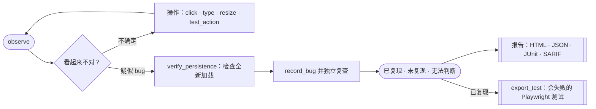

<div align="center">


# Argus

### 给 coding agent 用的测试工具：走真实流程、核实每个 bug、修好后不再复发。

Argus 是一个 [MCP](https://modelcontextprotocol.io/) server，给你正在用的 agent 补上完整的测试流程：
agent 像用户一样使用你的应用，Argus 独立复查看起来不对的地方，每个发现都注明依据。

[](https://pypi.org/project/argus-testing/)
[](https://pypi.org/project/argus-testing/)
[](https://modelcontextprotocol.io/)
[](LICENSE)

[快速开始](#快速开始) · [工作原理](#工作原理) · [0.12.0 更新](#0120-更新) · [为什么不同](#为什么不同) · [产品主页](https://yichenwu.dev/projects/argus) · [更新日志](CHANGELOG.md)

[English（主文档）](README.md) · 简体中文

</div>

本文对应 **0.12.0**。英文 README 是权威说明；代码、协议文档和发布说明以英文维护。

---

> **“测试 http://localhost:3000，找出真实的 bug。”**
>
> 这就是全部提示词。agent 通过 Argus 操作浏览器，走完你关心的目标流程，
> 在全新加载的页面上复查每个疑似 bug，最后交回报告。已核实的 bug 还能变成一个
> Playwright 测试，放进你的 CI。

<table>
<tr>
<td width="33%" valign="top">

**🧭 探索**

agent 按描述操作（`click_what("Delete near Buy milk")`），每次操作后直接看到页面变化；
声明的目标记在覆盖账本里，直到标记为已执行或受阻。

</td>
<td width="33%" valign="top">

**🔎 核实**

疑似 bug 会在全新加载的页面上独立复查。每个发现标为已复现、未复现、无法判断或仅观察，
主观判断不会冒充成已确认的 bug。

</td>
<td width="33%" valign="top">

**🛡️ 防止复发**

`export_test` 把已核实的 bug 变成独立的 Playwright 测试：现在失败，修好后通过。
`regression_check` 和 `argus-regression` 在新版本上复查以前的发现。

</td>
</tr>
</table>

## 快速开始

需要 **Python 3.11+** 和 Chromium。使用 [uv](https://docs.astral.sh/uv/) 时无需全局安装：

```bash
uvx --from playwright playwright install chromium
uvx --from argus-testing argus-mcp --doctor     # 检查 Chromium（真实启动一次）和报告目录
```

`--doctor` 的每项失败都会给出具体修复命令。默认 Python 较旧时，用
`uvx --python 3.12 --from argus-testing argus-mcp`。升级后提示浏览器缺失时，运行
`uvx --from argus-testing python -m playwright install chromium`。

然后把 Argus 接入你的 agent：

<details open>
<summary><b>Claude Code</b></summary>

```bash
claude mcp add argus -- uvx --from argus-testing argus-mcp
```

也可以安装 [Claude 插件](https://github.com/chriswu727/argus/tree/main/plugins/claude)，它固定已发布的版本，
并提供 `/argus-testing:test` 技能。先运行插件说明里的一次性预热命令，再用
`/plugin install argus-testing --marketplace chriswu727/argus` 安装。插件和手动配置二选一。
Claude 插件 0.12.1 更新了隔离启动方式，运行的 Argus 服务仍为 0.12.0。

</details>

<details>
<summary><b>Codex 与 ChatGPT 桌面应用</b></summary>

Codex CLI、Codex IDE 扩展和 ChatGPT 桌面应用共用一份 MCP 配置：

```bash
codex mcp add argus -- uvx --from argus-testing argus-mcp
```

也可以安装带 `argus-test` 技能的 [Codex 插件](https://github.com/chriswu727/argus/tree/main/plugins/codex)：
`codex plugin marketplace add chriswu727/argus`，再 `codex plugin add argus-testing@argus`。插件和手动配置二选一。

</details>

<details>
<summary><b>Cursor 及其他 stdio MCP 客户端</b></summary>

```json
{
  "mcpServers": {
    "argus": {
      "command": "uvx",
      "args": ["--from", "argus-testing", "argus-mcp"]
    }
  }
}
```

</details>

<details>
<summary><b>pip 安装与原生 macOS 模式</b></summary>

```bash
pip install argus-testing
playwright install chromium
claude mcp add argus -- argus-mcp

# 原生 macOS 应用测试
pip install 'argus-testing[mac]'
brew install cliclick
argus-mcp --doctor          # 还会检查屏幕录制和辅助功能授权
argus-mcp --tool-profile screen
```

原生模式默认有单次超时、30 分钟会话上限，以及 `~/.argus/abort` 紧急停止文件。

</details>

然后直接让 agent 测试你的应用。需要限定范围时，可以给 `start_session` 传入 `goals`、`constraints`
和参考性的 `time_budget_minutes`。不启动浏览器、不调用模型的安装检查：
`uvx --from argus-testing python -m argus.install_check`。升级后要重启 MCP 宿主。

---

## 工作原理



判断由 agent 做。Argus 提供：

- **按描述定位的工具：** `click_what("Login button")`，而不是 `click(7)`。`observe` 给出的描述可以原样传回；
  有歧义时返回候选，不会乱猜。
- **会报告变化的操作：** `test_action` 和 `test_form` 返回操作前后的差异和触发的请求；
  传入 `expect` 预测结果，不符时会提示，这正是 bug 线索。
- **覆盖账本：** 目标保持可见，直到带着证据标记为 `exercised` 或 `blocked`；
  这段时间内的 URL、操作、截图和检查会自动关联。
- **复现回执：** `record_bug` 先在全新加载的页面上复查指定现象，再判定为已复现；
  多步骤 bug 还能从冷启动重放整个流程。

回执只证明指定的可见现象，不证明根因，也不单独证明行为违反了需求。全新加载默认保留登录状态和存储；
重放可能重复真实写入，需要相应授权。

### 从已核实的 bug 到回归测试

发现经全新加载的文字检查复现后，`export_test` 会生成一个独立的 Playwright 测试：重放记录下的流程，
然后断言与 bug 现象相反的结果。**bug 存在时它失败，修好后它通过。**

- **定位稳定：** 定位写法来自 Argus 实际命中的元素；重复的按钮按所在行的标题定位，不依赖位置。
- **不写入密钥：** 密码和 token 从环境变量读取，不写进文件。
- **不把异常页面当成通过：** HTTP 错误页和登录页会中止检查；症状在这些页面上消失，不代表 bug 已修复。
- **不靠猜测：** 无法翻译的步骤标成 `TODO(argus)` 并列出。
- **可选试运行：** `run=true` 会立即运行一次，证明它在 bug 上失败。这会重复流程里的写操作，只在可以修改的数据上使用。

报告把已复现的现象、观察和无法判断的检查分开呈现，并保留未完成的目标，不会把不完整的测试说成全面覆盖。

---

## 0.12.0 更新

- **已核实的 bug → 回归测试：** 新的 `export_test` 从已复现的发现生成 Playwright 测试，现在失败、修好后通过。
- **现成的测试技能：** Claude 插件的 `/argus-testing:test` 和新的 Codex 插件里的 `argus-test`，
  会跑完整一轮测试：声明目标、用 `test_action` 预测结果、
  用 `screenshot` 和 `check_layout` 做视觉检查、核实发现并汇总覆盖情况。
- **真实应用中的交互：** 来自对 TodoMVC 和 Flask 教程应用的实测：
  - 悬停才出现的按钮；
  - 双击编辑，包括双击普通文字；
  - 确认弹窗，会报告出来，也可用 `accept_dialog=true` 接受；
  - 只靠旁边标签命名的输入框；
  - 后退和滚动，现在也会进入重放和导出的测试。
- **定位更准：** `observe` 给出的描述可原样使用；`test_form` 能勾选复选框和单选框；
  文字检查能处理目标两端的标点。
- **`--doctor` 覆盖网页测试：** 所有平台都会真实启动一次 Chromium，并检查报告目录。

**从 0.11 升级：** `web` 配置从 28 个工具变为 29 个，新增 `export_test`。完整变更见 [更新日志](CHANGELOG.md)。

<details>
<summary><b>0.11.0 更新</b></summary>

- **一个完整的默认测试闭环：** 28 个工具的 `web` 配置覆盖探索、操作、核验、记录、报告和
  `regression_check`。`advanced` 再加入网络、会话状态、多标签、坐标和爬取等能力。
- **更轻的安装：** 移除旧的 LLM 规划 CLI 和 LiteLLM，全新安装的运行时依赖从 82 个包降到 41 个。
- **更准确的证据：** 错误页上看到目标文字也算确定的结果；`expect_status` 用于声明预期的 404；
  复查回执会注明是第几次复查。

从 0.10 升级：`agent` 和 `core` 仍可启动，但都会加载 `web`；`check_links` 与 `check_performance`
移到 `advanced`；`argus <url>` 命令已移除。

</details>

---

## 为什么不同

| | |
|---|---|
| **agent 主导、黑盒测试** | 给 agent 一个 URL 和范围即可，不需要应用源码，也不需要预先写好的脚本。 |
| **覆盖约定** | 目标、约束、发现的页面和时间预算在整个会话和最终报告中都可见。 |
| **复现回执** | 独立检查把已复现、未复现、无法判断的现象与 agent 自己的观察区分开。 |
| **运行时证据** | 在真实运行的应用里抓出虚假的成功提示、跨页面不一致和保存后丢失；是否违反需求由 agent 判断。 |
| **发现 → 防护** | `export_test` 把已核实的 bug 变成测试放进你的测试套件；`argus-regression` 在 CI 里无模型复查历史发现。 |
| **机器可读** | 结构化 MCP 结果，以及 JSON、JUnit、SARIF 导出。 |

[Playwright MCP](https://github.com/microsoft/playwright-mcp#readme) 提供浏览器自动化和可选的测试断言。
Argus 围绕完整的测试过程：先声明目标并追踪到证据、写操作后检查持久化、把发现关联到背后的操作、检查和截图、
独立复查，并对历史发现生成回归测试和复查。Argus 自带浏览器控制，也能与其他工具并用；
它不取代宿主模型的判断，也不保证发现所有缺陷。

## 测试与效果边界

`34/34` 脚本基准表示工具能找到的合成缺陷上限，不是 agent 的成功率：

```bash
python test-site/app.py           # BuggyTasks  :5555，22 个机械类 bug
python human-eye-fixture/app.py   # DarkShop    :5556，12 个需要人眼判断的问题
python -m argus_lab.bench --target all
```

历史 [0.8 模型评测](docs/evaluation-0.8.md) 包含十组匹配实验：Argus 找到 6/6 个缺陷机会，
浏览器基线为 5/6；双方都没有观察到误报，目标覆盖相同，Argus 用了更多时间和 token。
样本很小，且包含事后修正的 fixture 问题，不能泛化为产品排名或全面优势。

无模型编码基准在 24 个合成响应上，delta 相比 compact 减少 **48.25%** 的结果 JSON 字节。
这是字节测量，不是模型 token、订阅消耗或测试质量的提升比例。方法和限制见[评测文档](docs/evaluation.md)。

## 工具配置

| 配置 | 工具数 | 用途 |
|---|---:|---|
| `web` | 29 | 默认配置：完整的浏览器测试闭环，使用简洁的工具描述。 |
| `advanced` | 62 | 在 web 基础上加入网络 mock、cookie/存储、多标签、弹窗、等待、坐标操作、爬取和链接/性能探测。 |
| `screen` | 14 | 原生 macOS Accessibility 与截图测试，需单独启用。 |
| `full` | 78 | 全部 web 与 screen 工具，包括屏幕坐标操作。 |

旧配置名仍可启动：`agent` 和 `core` 会加载 `web` 配置（工具数 19 → 29、30 → 29）。
完整工具说明见[英文工具目录](README.md#tool-surface)，操作准则见 [AGENTS.md](AGENTS.md)。

<details>
<summary><b>响应模式与证据约定</b></summary>

支持 MCP `structuredContent` 的宿主推荐使用：

```bash
uvx --from argus-testing argus-mcp --response-mode compact --monitor-port 8765
```

`compact` 减少重复文字，但保留结构化证据和图片。`delta` 是额外的可选模式，只适用于能保留 snapshot
并校验 `base_id` 的客户端；缺失 base 时调用 `observe` 重新同步，不能把旧的检查结果当成当前结果。

`status: completed` 只表示工具执行完成；`exercised` 只表示目标执行过，不等于通过。
持久化失败优先使用 `verify_persistence` 返回的 `suggested_verify`；`replay: true` 会重新执行流程，
可能重复真实写入，需要相应授权。复查已有发现时使用 `finding_id`。

</details>

<details>
<summary><b>报告、回归与清理</b></summary>

默认输出目录是 `./argus-reports`（`ARGUS_OUTPUT_DIR` 可修改）。HTML 通常引用紧凑的 WebP 预览并保留原始截图；
`ARGUS_PORTABLE_REPORT=1` 生成单文件 HTML。

```bash
argus-regression http://localhost:3000 --output ./argus-reports
argus-cleanup --output ./argus-reports --keep-runs 20
# 确认清理计划后才实际删除：
argus-cleanup --output ./argus-reports --keep-runs 20 --apply
```

回归退出码：`0` 未复现已知现象或 journal 为空，`1` 已知现象仍存在，`2` 操作/存储失败，`3` 无法判断。
`0` 不是应用完全正确的证明。自动回归不执行可能写入数据的重放。清理默认 dry-run，不删除 journal 和 state capsule。

</details>

<details>
<summary><b>实时监控</b></summary>

```bash
argus-mcp --monitor-port 8765
# 自动选择空闲端口：
argus-mcp --monitor-port 0
```

打开 `http://127.0.0.1:8765` 查看会话状态、当前操作、发现和最近事件；还提供 `/healthz`、`/readyz`、
`/api/status`、`/api/events`（SSE）和 `/metrics`。监控只监听本机，没有操作接口，
不包含页面内容、URL、输入值、截图或工具参数。它不是带认证的远程服务，不能暴露到公网。

</details>

## 安全与隐私

Argus 没有维护者运营的遥测服务，但 MCP 宿主及其模型提供商可能收到对话中的工具结果。
浏览器或原生操作会产生真实副作用，尽量使用测试账号和非生产数据。

- `eval_js` 默认禁用，只有显式 `--unsafe` 才启用。
- 上传和 `file://` 页面需要在启动时用 `ARGUS_FILE_ROOTS` 授权的目录。
- 可选的 `ARGUS_ALLOWED_ORIGINS` 限制工具目标，但不是网络防火墙。
- Cookie/storage 值默认隐藏；仅在有授权时启用 `ARGUS_ALLOW_SENSITIVE_READS=1`。
- 输入值保存在会话内的输入保险箱中，不进入操作记录；导出的测试从环境变量读取敏感输入。
- State capsule 故意包含原始凭据，不能公开分享。截图和自由文本仍可能含有应用数据，分享前请检查。

完整边界见 [SECURITY.md](SECURITY.md) 和 [PRIVACY.md](PRIVACY.md)。

## 许可证

[MIT](LICENSE) · 作者 [Yichen Wu](https://github.com/chriswu727)
