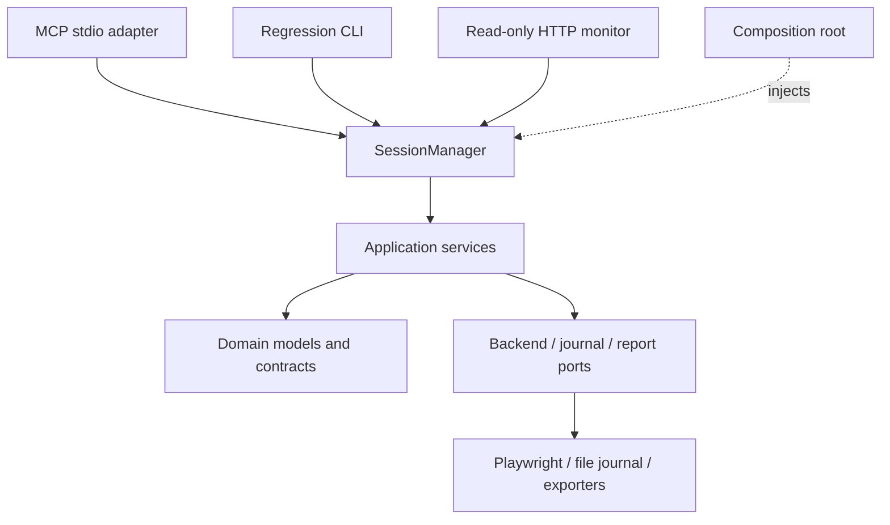

# Architecture: Argus 0.10

Argus is a local, single-session QA runtime with MCP and CLI entry points. It is
a modular monolith, not a distributed service. The host model decides what to
test; Argus owns browser execution, evidence and bounded verification.

The arrow means a call/dependency direction. `bootstrap.py` chooses concrete
implementations. Domain code has no protocol/browser dependency. Tool schemas
and MCP image conversion live in `entrypoints/mcp`; application operations return
plain values and `ImageArtifact`. The historical root modules retain compatibility
imports while implementations move to focused packages. Architecture tests forbid
private adapter access, protocol imports in services and runtime import cycles.

## Ownership and request path

Each `SessionManager` owns settings, one session, a lock, verifier registry,
injected factories/repository, metrics and event ring. No production request
uses the compatibility module's default session. Multiple runtimes can coexist
without sharing session state; the supported stdio deployment is one runtime
per process.

1. MCP validates the tool schema and resolves the registered operation.
2. The manager waits up to the queue timeout for its operation lock.
3. Inside the lock it sets an invocation-local `ContextVar`, emits metadata-only
   start telemetry, and runs the operation with a deadline.
4. The service mutates session/domain data and calls public backend interfaces.
5. The manager classifies failures, updates metrics/events and releases the lock
   in `finally`. The MCP adapter maps operational errors to `isError` results.

The context variable preserves small existing tool signatures; it is not a
global mutable session and is reset after each invocation. Direct new callers
must use `execute`. Context propagates to `asyncio.to_thread` report writes.

## Lifecycle and concurrency

Normal lifecycle: `idle → starting → active → stopping → idle`. Failed start,
deadline expiry or cancellation moves to `failed`; only end/restart operations
are accepted there. A replacement first closes the previous backend, then
assigns the new session before launch so partially initialized resources have
an owner. A backend that fails teardown remains owned for a later cleanup retry.

All actions, not just start/end, share the same lock. Queue timeout rejects a
waiting request without cancelling the owner. Operation timeout cancels the
running coroutine and closes backends under bounded per-backend cleanup waits.
Shutdown marks the runtime unready, cancels/awaits active work, acquires the lock,
closes remaining resources and closes the event stream. End without resources
is idempotent. There is no automatic retry for potentially non-idempotent writes.

Timeouts are cooperative: Python cannot forcibly terminate a blocked synchronous
library call or a filesystem worker thread. Reports can finish after caller
cancellation; their file locks still protect concurrent cleanup. Process kill
does not promise a final report. This is not a durable job scheduler.

## Verification and trust

`VerificationSpec` validates built-in text/HTTP/replay requests. The strategy
registry separates dispatch from findings. A receipt distinguishes reproduced,
not reproduced and inconclusive; it is evidence for a declared predicate, not a
proof of semantic correctness or root cause. Text/HTTP checks reload twice and
suspend injected mocks. Auth cookies remain; clearing client storage is opt-in.
Replay uses a separate browser context but can still repeat backend writes.

CLI and MCP regression share `check_entries` and the same registry. Automatic
regression refuses replay and custom strategies because their side effects are
unknown. Invalid/corrupt journals are operational failures, not empty clean
runs. Exit 3 means inconclusive; exit 0 can also mean there were no findings to
check. The older autonomous LiteLLM explorer is a separate workflow.

## Finding and coverage evidence

`domain/findings.py` declares the optional MCP evidence shape; domain `Bug`
records retain expected/actual outcomes, explicit goal associations and
caller-claimed call references separately from independent receipts.
`application/findings.py` validates metadata and coordinates evidence capture.
Fresh-load verifiers capture on the checked page before restoring the caller;
screenshot failure does not change the three-state verification outcome. The
registry keeps the three-argument strategy extension interface.

`application/coverage.py` owns validated atomic coverage updates and start/end
cursors. Switching groups closes prior ranges without inferring completion.
Action URLs preserve revisits; late explicitly linked findings can refresh a
closed goal's references without entering unrelated goals. Reopening a goal
starts a new range. Batched related goals intentionally share a journey window.
Final batches validate before teardown; compact evidence sharing belongs to
the MCP presentation layer, not report persistence or domain verification.

## Privacy and persistence

`AccessPolicy` is immutable startup configuration shared by the runtime and
browser adapter. It validates explicit tool targets and local file inputs;
`permission_denied` is distinct from a browser failure. Resolved filesystem
containment and optional full-origin matching are application-level guards,
not an OS sandbox or egress firewall. See [Security](../SECURITY.md) for limits.

Input values live in an `InputVault`, referenced by opaque IDs in session action
traces. Exporters remove references and mark input-dependent replay steps.
Missing input fails closed. Closing a backend clears the vault. This does not
scrub screenshots, arbitrary user-authored evidence or Python process memory.

Every built-in report renderer receives a recursively redacted copy through the
shared reporting privacy wrapper. The reporter also sanitizes inputs to custom
exporters. Structured JSON, URLs and common credential headers are handled
centrally; multipart inspection is omitted. Live replay inputs and executable
journal conditions are not rewritten to redaction placeholders.

Files use temp-write, flush, fsync and atomic replace. Journals use a versioned
envelope (legacy lists remain readable); capsules and JSON reports are versioned.
Journal read/merge/write holds an OS-backed file lock. The OS releases locks on
exit; lock files are never unlinked because waiters may hold their inode. Report
generation and cleanup use the same per-run lock. There is no multi-file
transaction, database-grade crash recovery or network-filesystem guarantee.
Only complete individual file replacement is atomic; directory metadata is not
explicitly fsynced. Storage errors are surfaced; secondary export failures do
not erase an already-written primary HTML report.

Capsules intentionally contain credentials, have owner-only POSIX file modes,
and are not encrypted. Run IDs prevent collisions. Retention is explicit and
dry-run by default. Cleanup does not touch journals/capsules or unknown custom
export formats; those require their own retention policy.

## Monitoring and limits

The optional HTTP server shares the runtime but does not take its operation
lock. A slow browser operation therefore remains visible. Endpoints expose
liveness, readiness, current state, counts, SSE and Prometheus metrics. SSE uses
one bounded ring with sequence cursors, not an unbounded queue per subscriber.
Old/future cursors receive a gap notice; disconnect releases the subscription.
The maximum is 32 subscribers, with 10-second heartbeats.

Only loopback is bound. Host, Origin and Fetch-Site checks defend the local
browser surface; CSP and `textContent` avoid rendering event text as markup.
There are no remote control endpoints or authentication. Other local processes
can read the monitor. Neither this nor MCP annotations form an authorization
boundary for browser actions. Never expose the port to the internet.

Operational failure metrics count classified manager failures, not every
semantic diagnostic such as a layout warning or failed reproduction. A tool
can succeed while finding an application bug. Queue rejections happen before
execution and are not included in execution-duration/call counters.

Browser capture logs and monitor events are bounded. Response capture is
content-type/length-gated and credential-redacted; a lying Content-Length or
decompression expansion is not a hard process-memory cap. Session evidence,
screenshots and input values grow with work until end/cleanup. The advisory
review budget is not an enforced web-session lifetime limit.

## Verification boundaries

Tests cover fake-backend faults, independent runtimes, input privacy, lock
contention, report formats, browser fixtures, real MCP stdio and live HTTP/SSE.
Ruff covers Python sources/tests. Mypy is intentionally scoped to the new core,
not advertised as whole-project strict typing. CI tests Python 3.11/3.12 and
Chromium. Native macOS UI permissions and behavior require manual integration
testing; unit tests alone do not establish native app correctness.

See [design decisions](decisions.md) and the [extension guide](../CONTRIBUTING.md).

## Agent interface and evaluation

The MCP adapter adds a versioned `AgentResult` envelope while preserving text
and image blocks. Application services expose `ToolText` evidence without MCP
dependencies; the adapter does not scrape prose to reconstruct evidence. The
runtime captures result state while holding the operation lock. Core payloads
bound target/feedback counts and identify omissions.

Progress is a request-local context with a bounded stage list and a best-effort
notification sink. Fixed phases are emitted at actual work boundaries into both
MCP progress and the existing monitor event stream. Delivery has a short deadline
and cannot prevent lock release or convert a failed reproduction into success.

`evaluation/` owns paired records, validation, deterministic local smoke fixtures
and offline scoring. The production runtime never imports it. Real model drivers
and independent adjudication remain external inputs; scripted controls are
explicitly not agent-effectiveness evidence. See [protocol](agent-protocol.md)
and [evaluation](evaluation.md) for compatibility and measurement limits.

`application/guidance.py` owns deterministic next-check hints and a per-session
visible-state fingerprint. It imports no model provider and executes no actions.
`payloads.py` joins post-action state, coverage and hints; MCP response mode is an
operator setting interpreted only by the presentation adapter. The monitor gets
numeric summaries, not free-text goals or evidence.

`entrypoints/mcp/snapshots.py` owns the optional one-observation delta cache; it
operates only on redacted presentation data and never changes domain verdicts,
browser state, coverage accounting or report persistence. Its explicit base IDs,
bounded retention and full-observation recovery keep cache loss visible. The
default compatible output and application APIs are unchanged.

`measurement.py` provides request-local, framework-independent timing scopes.
Browser/report adapters instrument fixed categories; the MCP boundary aggregates
numeric measurements in the runtime. `entrypoints/mcp/overhead.py` measures
serialized transport content without retaining it. Monitoring exposes those
numbers only. Discovery measurements and reproducible encoding comparisons
belong to the separate evaluation package, not the production testing workflow.

The opt-in evaluation collector is a separate POSIX process supervisor. Its MCP
gateway enforces the tool budget; its host subprocess has no shell or web tools.
Fixture state and oracle events stay in the supervising process. Collection and
adjudication are separate steps, so model self-certification cannot directly
become a benchmark true positive. This is a synthetic evaluation boundary, not a
general-purpose sandbox for hostile web content.
